# Windows Stats

[English](README.md) · **Türkçe**

Windows 10 ve Windows 11 için görev çubuğunda çalışan, hafif ve gizlilik dostu bir sistem izleme
uygulaması. macOS'taki [Stats](https://github.com/exelban/stats) uygulamasından esinlenmiştir ve
[winstats](https://github.com/mgvs/winstats) (Oleksandr Zhabotynskyi, MIT) temel alınarak
geliştirilmiştir.

- **Görev çubuğunun içinde** çalışan şerit: CPU (çekirdek başına çubuklar, P/E çekirdek ayrımı,
  geçmiş grafiği), GPU, RAM, disk, ağ, pil ve sıcaklık widget'ları. Windows görev çubuğuna gömmeye
  izin vermezse aynı yerde **yüzen** şerit olarak çalışır.
- Widget'a tıklayınca **ayrıntılı panel**: geçmiş grafikleri, en çok kaynak kullanan işlemler,
  çekirdekler ve frekanslar, bellek modülleri, fiziksel diskler (SSD/HDD, sıcaklık), sürücüler, ağ
  bağdaştırıcıları (Wi-Fi ağı, IP, MAC, hız), pil, sensörler.
- **Ayarlar penceresi** (sağ tık > Ayarlar…): widget seçimi ve sıralaması, renkler, tema
  (sistem/koyu/açık), yazı ve grafik boyutları, güncelleme aralığı (0,5 / 1 / 2 / 5 sn), konum,
  Windows ile başlatma, eşik bildirimleri, sensörler, gizlilik.
- **Bildirimler**: örneğin "İşlemci sıcaklığı 30 sn boyunca 85 °C üzerinde kalırsa uyar".
  Ölçülemeyen değerler hiçbir zaman bildirim üretmez.
- Tamamen **Türkçe** arayüz (Windows dili Türkçe ise otomatik), Türkçe birimler (KB/sn, 1,5 GB).

## Ekran görüntüleri

Görüntüler, ayrı ayar klasörü kullanan Windows test örneğinde uygulamanın kendi tuvalinden
alındı; arayüz Türkçe, tema koyu. Ayrıntı panellerindeki süreç adları, IP/MAC adresleri,
bağdaştırıcı bilgileri ve sürücü etiketleri gizlendi; kapatılan alanlar `[gizlendi]` olarak işaretlendi.

**Görev çubuğu şeridi**

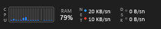

| İşlemci | Bellek |
|---|---|
| 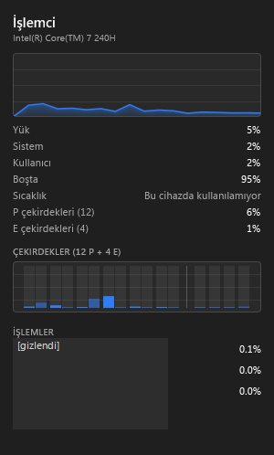 | 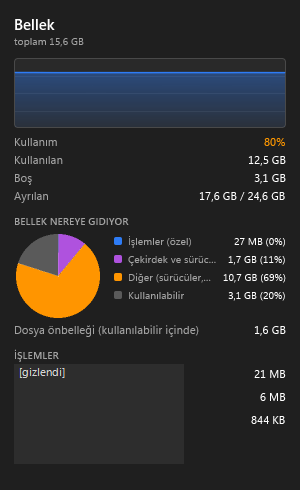 |
| **Ağ** | **Disk** |
| 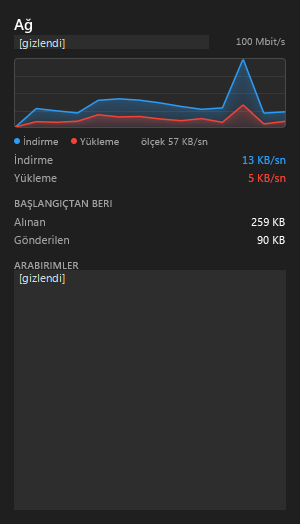 | 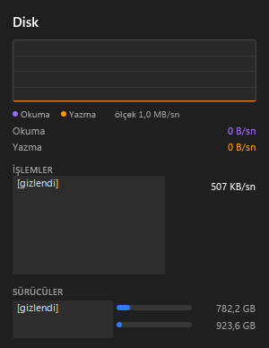 |

**Genel ayarlar**

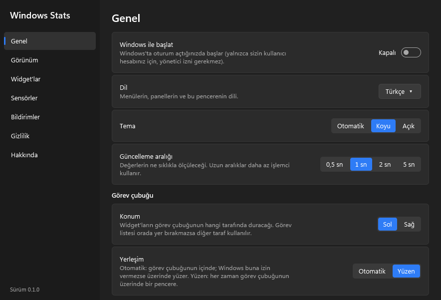

<details>
<summary>Diğer ayar sayfaları</summary>

**Görünüm**

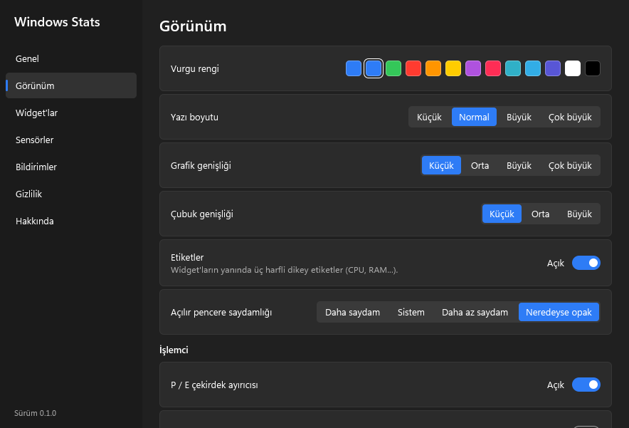

**Widget'lar**

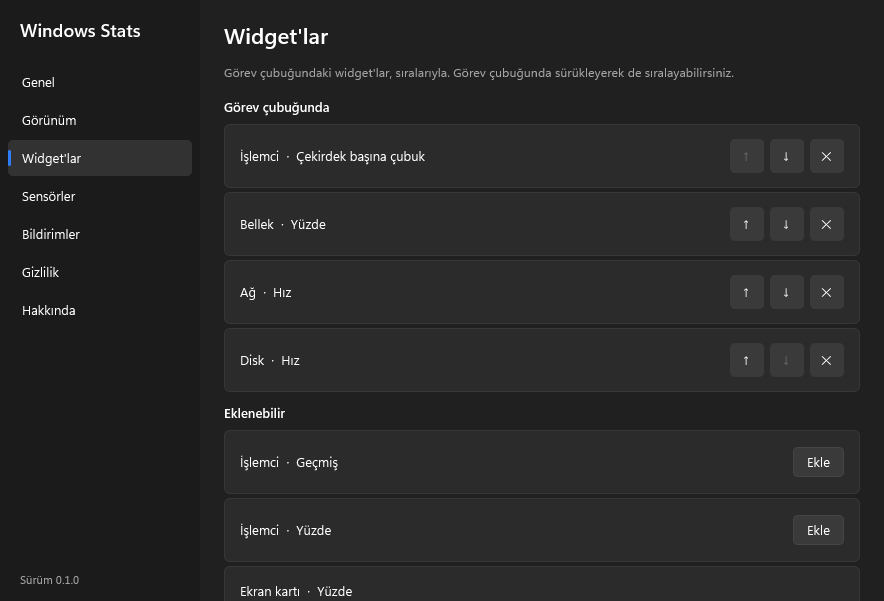

**Sensörler**

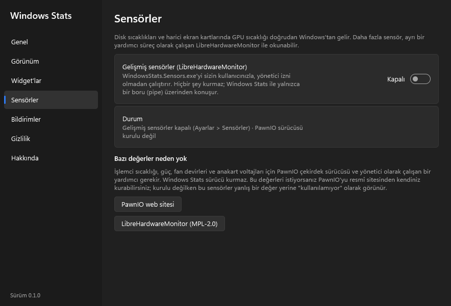

**Bildirimler**

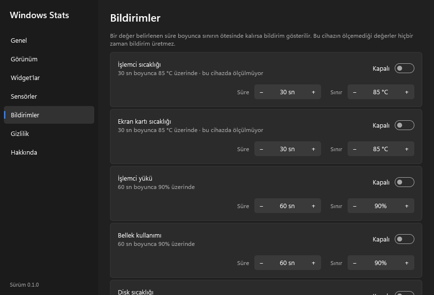

**Gizlilik**

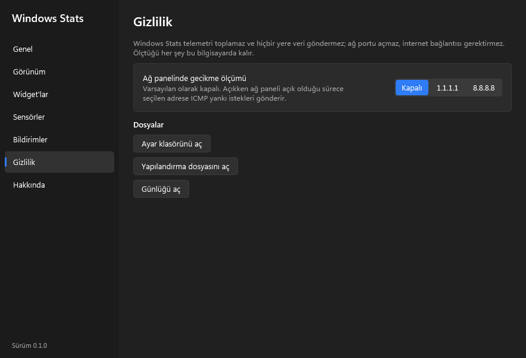

**Hakkında**

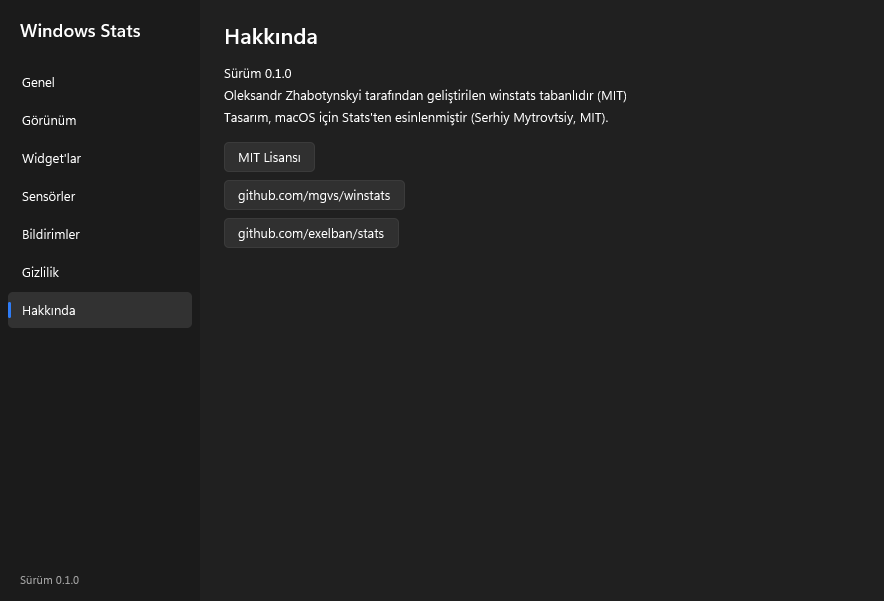

</details>

Sensör ayrıntı panelinin görüntüsü yok: bu test örneğinde sıcaklık verisi alınamadığı için sensör
widget'ı görünmedi. Yukarıdaki sensör ayarları sayfası mevcut seçenekleri gösteriyor.
Bu görüntüleri yeniden hazırlamak için [çekim rehberine](docs/screenshots.md) bakabilirsiniz.

## Kurulum

Yönetici izni gerekmez, yalnızca sizin kullanıcı hesabınıza kurulur.

1. `WindowsStats-<sürüm>-x64.zip` dosyasını bir klasöre açın.
2. `Kur.cmd` dosyasına çift tıklayın. Program `%LOCALAPPDATA%\Programs\Windows Stats` klasörüne
   kopyalanır, Başlat menüsüne eklenir ve isterseniz Windows ile birlikte başlar.
3. **Kaldırma:** Ayarlar > Uygulamalar > Windows Stats > Kaldır. Görev çubuğu eski haline döner;
   ayarlarınızın silinip silinmeyeceği sorulur.

Kurmadan denemek için `WindowsStats.exe` doğrudan da çalıştırılabilir.

## Kullanım

- **Sol tık:** widget'ın ayrıntılı paneli. **Sağ tık:** hızlı ayar menüsü (en üstte *Ayarlar…*).
- **Sürükle-bırak:** widget'ları şerit üzerinde sürükleyerek sıralayın.
- **Çift tık:** Görev Yöneticisi.
- Windows 11'de şerit, görev listesinin düğmelerine binmez. Seçilen tarafta yer yoksa diğer
  tarafa geçer, orada da yetmezse sondaki widget'lar yer açılana kadar gizlenir.

## Sensörler

| Değer | Kaynak | Yönetici izni / sürücü |
|---|---|---|
| Disk sıcaklığı, SSD/HDD | Windows depolama sorgusu | Gerekmez |
| GPU sıcaklığı, fan | Ekran kartı sürücüsü (Görev Yöneticisi'nin kaynağı) | Gerekmez (harici GPU'larda) |
| GPU saat hızı, voltaj, ek değerler | LibreHardwareMonitor yardımcısı | Gerekmez |
| İşlemci sıcaklığı, güç, fanlar, anakart voltajları | LibreHardwareMonitor + PawnIO sürücüsü | **Yönetici izni gerekir; bu imzasız sürümde etkin değil** |

Gelişmiş sensörler varsayılan olarak kapalıdır (**Ayarlar > Sensörler**). Açıldığında ayrı bir
süreç olan `sensors\WindowsStats.Sensors.exe` kullanıcı yetkileriyle çalışır (yaklaşık 80–100 MB
bellek). Windows Stats **hiçbir sürücüyü kendisi kurmaz**. **Yönetici olarak çalıştırma güvenlik
nedeniyle kapalıdır:** imzasız yardımcı dosya kullanıcı tarafından değiştirilebilen bir klasörde
bulunduğu için yükseltilmiş yetkiyle başlatılması güvenli değildir. PawnIO'yu
[resmî sitesinden](https://pawnio.eu) ayrıca kurmuş olsanız bile işlemci sıcaklığı ve yalnızca
PawnIO ile okunabilen bazı değerler kullanılamayabilir. Desteklenmeyen sensörler sahte değer
yerine **"Bu cihazda kullanılamıyor"** olarak görünür.

## Gizlilik ve güvenlik

- Telemetri, analitik ve otomatik güncelleme kontrolü **yoktur**. Uygulama ağ portu açmaz ve
  internet bağlantısı gerektirmez.
- Tek isteğe bağlı ağ işlemi ağ panelindeki gecikme ölçümüdür. Varsayılan olarak kapalıdır ve
  açıldığında yalnızca seçtiğiniz adrese ICMP gönderir.
- Yönetici izni istemez (`asInvoker`). Yalnızca kullanıcıya ait anahtarları (`HKCU`) kullanır.
- Ölçümler ayrı bir iş parçacığında yapılır; görev çubuğuna gömülü pencere hiçbir zaman ölçüm
  beklemez. Böylece Explorer'ın donması önlenir. Explorer yeniden başlarsa şerit kendini yeniden
  bağlar.
- Ayarlar `%APPDATA%\WindowsStats\config.toml` dosyasında, günlük ise `WindowsStats.log`
  dosyasında tutulur.

## Derleme

Yönetici izni gerektirmeyen, proje içi bir araç zinciri kullanılır (`.toolchain`, git'e dahil
değildir):

- Rust 1.99, `x86_64-pc-windows-gnu`: `rustup-init.exe -y --no-modify-path --default-host x86_64-pc-windows-gnu`
  ile `RUSTUP_HOME`/`CARGO_HOME` değişkenleri `.toolchain\rustup` ve `.toolchain\cargo` gösterecek
  şekilde kurulur.
- [llvm-mingw](https://github.com/mstorsjo/llvm-mingw): yalnızca simge ve manifest için `windres`.
  `.toolchain\llvm-mingw` klasörüne açılır.
- .NET SDK 8+ (yalnızca isteğe bağlı sensör yardımcısı için).

```powershell
powershell -ExecutionPolicy Bypass -File scripts\build.ps1 -Test
```

Çıktı: `target\release\WindowsStats.exe` ve `dist\WindowsStats-<sürüm>-x64.zip` (uygulama,
sensör yardımcısı, lisanslar, `Kur.cmd`).

## Komut satırı

```
WindowsStats.exe                   başlat
WindowsStats.exe --settings        ayarlar penceresini aç
WindowsStats.exe --install         kullanıcıya özel kur (--quiet: soru sormadan)
WindowsStats.exe --uninstall       kaldır (--quiet: soru sormadan, ayarlar korunur)
WindowsStats.exe --quit            çalışan uygulamayı temiz biçimde kapat
WindowsStats.exe --dump 10 1000    10 ölçümü JSON satırları olarak yazdır
WindowsStats.exe --taskbar-items   görev çubuğu öğelerini listele (tanı)
WindowsStats.exe --version
```

## Testler

Windows derlemesi, birim testleri, CLI CPU/bellek kontrolü ve isteğe bağlı sensör yardımcısının derlemesi GitHub Actions üzerinde çalışır. [CI kapsamı ve sınırlamaları](docs/ci.md) fiziksel donanım ve görev çubuğu testlerinden ayrıdır.


```powershell
cargo test --release                                                   # birim testleri
powershell -ExecutionPolicy Bypass -File scripts\compare-taskmgr.ps1   # Görev Yöneticisi sayaçlarıyla karşılaştırma
```

`tools\uitest` arayüz testleri için ekran yakalama ve fare yardımcısıdır (dağıtıma dahil değildir).

## SSS ve bilinen sınırlamalar

**SmartScreen veya antivirüs neden uyarı veriyor?** Uygulama şu an kod imzalı değil. SmartScreen tanınmayan yayıncı uyarısı verebilir; antivirüsler yeni bir sürümü sezgisel olarak işaretleyebilir. Yalnızca bu deponun Releases sayfasından indirin. İşaretlenen dosyayı inceleme için ilgili üreticiye gönderin; korumayı kapatmayın ve her uyarının yanlış pozitif olduğunu varsaymayın.

**CPU sıcaklığı neden görünmüyor?** Gelişmiş CPU sensörleri için isteğe bağlı LibreHardwareMonitor yardımcısı ve ayrıca kurulmuş PawnIO sürücüsü gerekir. Ayarlar > Sensörler bölümünden yardımcıyı açın. Güvenlik nedeniyle bu imzasız sürüm yönetici modunu desteklemez. Windows Stats kendiliğinden sürücü kurmaz. Donanım desteği değişir; okunamayan değerler kullanılamıyor olarak gösterilir.

**Şerit her monitörde gösterilebilir mi?** Şerit şu an yalnızca ana monitörün görev çubuğunda görünür. Birden fazla monitörde şerit desteklenmiyor.

**Şerit neden yüzüyor veya bazı bileşenler gizleniyor?** Windows görev çubuğuna gömmeye izin vermediğinde aynı bölgede yüzen moda geçer. Windows 11'de görev düğmelerini kapatmamak için taraf değiştirebilir veya sondaki bileşenleri gizleyebilir. Tam ekran uygulamalarda gizlenir.

**Sorunları nereye bildirebilirim?** Windows sürümü/derlemesi, uygulama sürümü ve tekrar etme adımlarıyla bir issue açın. `%APPDATA%\WindowsStats\WindowsStats.log` dosyasını eklemeden önce kişisel bilgileri temizleyin.

## Kod imzalama politikası

Sürümler şu an imzasızdır. Planlanan onay süreci ve gizlilik ilkeleri [Code signing policy](CODE_SIGNING.md) belgesinde yer alır; imzalama henüz etkin değildir.

## Teşekkürler

Windows Stats başkalarının emeği üzerine kuruldu. Teşekkürler:

- **[Oleksandr Zhabotynskyi](https://github.com/mgvs)**, **[winstats](https://github.com/mgvs/winstats)**
  için (MIT). Windows Stats onun bir çatalıdır: görev çubuğuna gömme, ölçüm toplayıcıları,
  paneller, menü ve çeviriler oradan başladı.
- **[Serhiy Mytrovtsiy](https://github.com/exelban)**, **[Stats](https://github.com/exelban/stats)**
  için (MIT). Sade menü çubuğu widget'ları ve panelleri bu projenin görünüm ve davranışına örnek oldu
  (kodu kullanılmadı).
- **[LibreHardwareMonitor](https://github.com/LibreHardwareMonitor/LibreHardwareMonitor) katkıcıları**,
  isteğe bağlı sensör yardımcısının dayandığı kütüphane için (MPL-2.0); DiskInfoToolkit,
  RAMSPDToolkit ve BlackSharp için **[Blacktempel](https://github.com/Blacktempel)**.
- **[namazso](https://github.com/namazso)**, eski ve güvenlik açığı bulunan WinRing0 sürücüsüne gerek
  bırakmadan işlemci sıcaklığını okunabilir kılan **[PawnIO](https://pawnio.eu)** ve PawnIO.Modules için.
- **James F. Bellinger**, [HidSharp](https://www.zer7.com/software/hidsharp) için (Apache-2.0).
- **Microsoft ve [windows-rs](https://github.com/microsoft/windows-rs) katkıcıları**, Windows API'sinin
  Rust bağlamaları için; .NET kütüphaneleri için **.NET Foundation**.
- **[serde](https://serde.rs) ve [toml](https://github.com/toml-rs/toml) geliştiricileri**,
  **[winresource](https://github.com/BenjaminRi/winresource)**,
  [llvm-mingw](https://github.com/mstorsjo/llvm-mingw) için **Martin Storsjö** ve **Rust projesi**.

## Lisans

MIT. Ayrıntılar ve kullanılan açık kaynak bileşenler: [LICENSE](LICENSE),
[THIRD-PARTY-NOTICES.md](THIRD-PARTY-NOTICES.md), `licenses\`.
